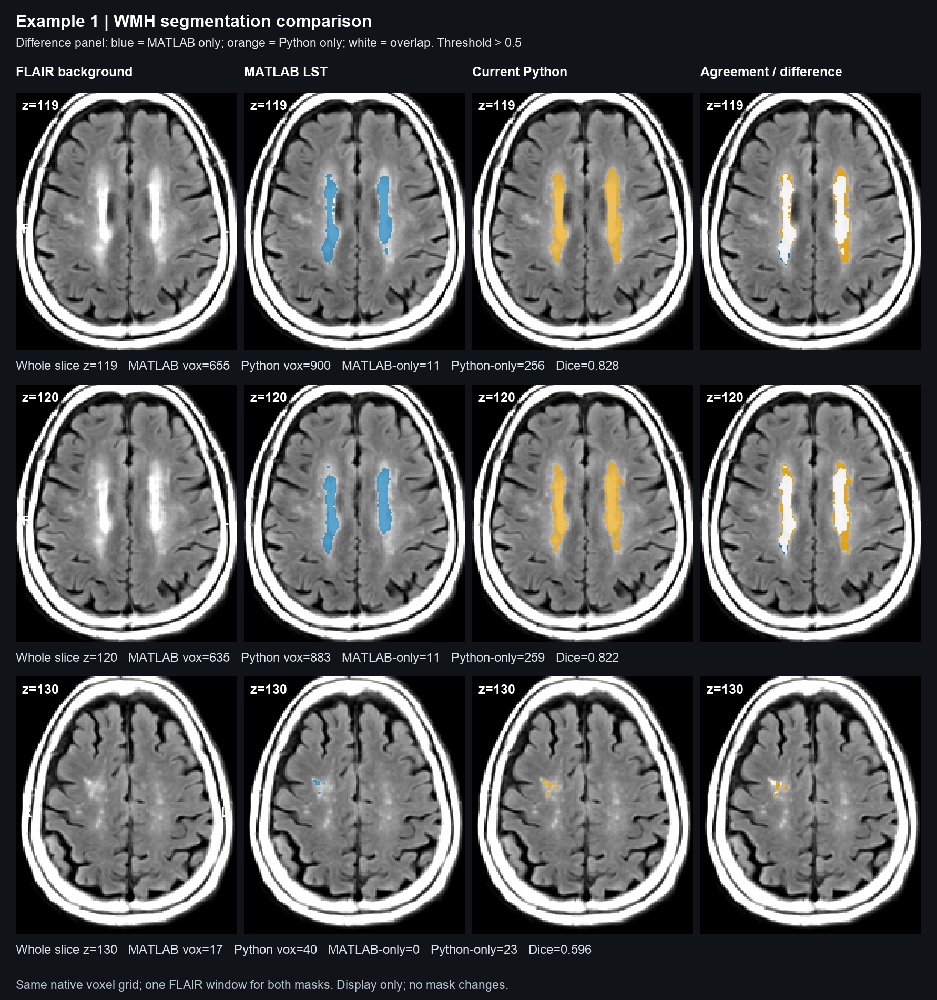
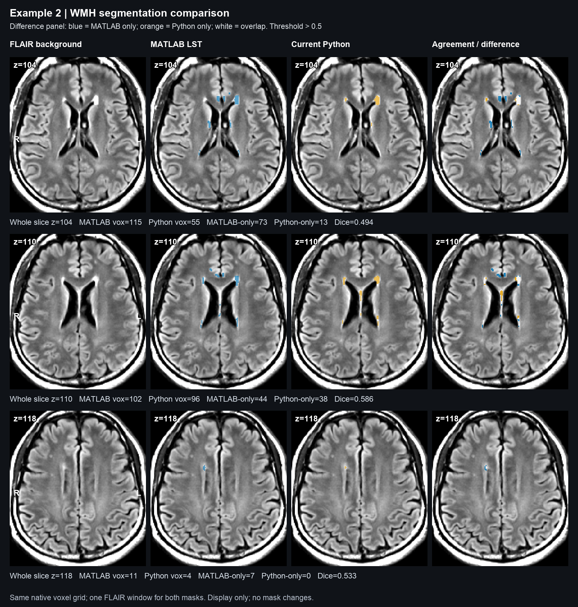

# WMH-Age-Prediction

Automated White Matter Hyperintensity (WMH) segmentation and WMH-based Brain Age Estimation pipeline for T1-weighted and 3D T2-FLAIR brain MRI scans.

This repository provides two pipelines:

1. **`pywmh_tool`**: Python/FSL pipeline using native-space **LST-LGA** and spatial priors; no MATLAB or SPM required.
2. **`AutomatedWMHAge.m` / `run_wmh_age.sh`**: The optimized legacy MATLAB pipeline using SPM12 and the LST toolbox, enhanced for headless command-line batch processing without GUI popups.

---

## Background & Methodology

The brain age prediction model is based on the publication:
> **Chu-Chung Huang, et al. (2022)**. *Brain white matter hyperintensities-predicted age reflects neurovascular health in middle-to-old aged subjects*. **Age and Ageing**, 51(5), afac106. [https://doi.org/10.1093/ageing/afac106](https://doi.org/10.1093/ageing/afac106)

The model computes volumes for:

- **PVWMH** (Periventricular White Matter Hyperintensity, ≤ 10 mm from ventricular lining)
- **DWMH** (Deep White Matter Hyperintensity, > 10 mm from ventricular lining)

The predicted WMH Brain Age is estimated via:

$$
\text{Predicted Age} = 11.069 \cdot \log_{10}(\max(V_{\text{PV}}, 10^{-4})) + 1.624 \cdot \log_{10}(\max(V_{\text{D}}, 10^{-4})) + 64.159
$$

---

## 1. Pure Python Standalone Pipeline (`pywmh_tool.py`)

### Algorithmic Framework: Native Python LST-LGA
The Python pipeline uses FSL for T1/FLAIR preprocessing and a native implementation of the [LST Lesion Growth Algorithm](https://www.applied-statistics.de/lst.html). Tissue maps and spatial priors initialize lesion seeds, followed by iterative region growing.

The default seed threshold is `--kappa 0.3`. Lower values initialize more seeds; higher values are more conservative. The complete FSL pipeline is not equivalent to SPM/LST; see [native LGA validation](docs/native_lga_validation.md) and [FLAIR preprocessing validation](docs/flair_preprocessing_validation.md).

### Requirements

- Python 3.8+
- [FSL](https://fsl.fmrib.ox.ac.uk/fsl/fslwiki) (FLIRT, BET, FAST, APPLYWARP)
- Python packages:
  ```bash
  pip install -r requirements.txt
  ```

### Usage

```bash
python pywmh_tool.py \
  --t1 /path/to/T1w.nii.gz \
  --flair /path/to/FLAIR.nii.gz \
  --age 65.0 \
  --age-correction linear-reference-v1 \
  --outdir /path/to/output_directory \
  --kappa 0.3
```

**The example enables age correction.** `--age` alone computes raw PAD; add `--age-correction linear-reference-v1` to obtain corrected results.

#### Arguments:

- `--t1`: Path to T1-weighted structural MRI scan (`.nii` or `.nii.gz`).
- `--flair`: Path to a FLAIR MRI scan (`.nii` or `.nii.gz`).
- `--age`: (Optional) Subject's chronological age at scan. Computes raw PAD (Brain Age Gap).
- `--age-correction linear-reference-v1`: Enable corrected WMH age and corrected PAD; requires `--age`. Omit to retain the original raw-only behavior.
- `--outdir`: Directory to save outputs.
- `--kappa`: Initial lesion belief threshold (default: `0.3`, standard LST-LGA setting).
- `--skip-qc`: (Optional) Skip generating visual QC HTML/PNG reports.
- `--force`: (Optional) Force re-running all steps even if intermediate files exist.
- `--nonlinear`: Use FSL FNIRT for non-linear registration to MNI (default: 12-DOF affine FLIRT for speed).
- Configure the FSL installation through `$FSLDIR` and ensure its commands are on `$PATH`.

### Outputs

- `WMH_Age_QC_Report.html`: Self-contained HTML report with embedded high-resolution graphics, metrics tables, GMV / WMV / CSFV / estimated TIV, and registration sanity checks. When correction is enabled, raw and corrected WMH age / PAD are shown together.
- `qc_summary.png`: Multi-slice overview with tissue volumes and raw / corrected age results.
- `WMH_Age_Results.csv`: Extended summary table with Total WMH, PVWMH, DWMH, GMV, WMV, CSFV, estimated TIV, % TIV, Predicted Age, Brain Age Gap, Lobar WMH (Frontal, Parietal, Temporal, Occipital, Subcortical), and Arterial Vascular WMH (ACA, MCA, PCA, VB).
- `WMH_Age_Results.json`: Comprehensive machine-readable quantification results.
- `bles_lga_k30.nii.gz`: Native-space binary WMH lesion mask.
- `ples_lga_k30.nii.gz`: Native-space lesion probability map.
- `native_PVWMH.nii.gz`: Native-space periventricular mask.
- `native_DWMH.nii.gz`: Native-space deep white matter mask.
- `native_lobar.nii.gz`: Native-space cerebral lobar parcellation.
- `native_arterial.nii.gz`: Native-space arterial vascular territory parcellation.
- `rmFLAIR.nii.gz`: Rigidly co-registered FLAIR aligned to T1.
- `flair_bias/FLAIR_corrected.nii.gz`: Bias-corrected FLAIR in its original acquisition space.
- `flair_bias/rmFLAIR_corrected.nii.gz`: Corrected FLAIR aligned to T1, used for LGA and QC.
- `flair_bias/correction_inputs.json`: Correction settings, source hashes and corrected-output hashes. Legacy lesion maps are regenerated when the corrected LGA input changes.

Tissue volumes integrate native FAST partial-volume maps: `TIV = GMV + WMV + CSFV`. This FAST/BET estimate depends on brain extraction coverage. Lesion-only input cannot provide tissue volumes.

---

## 2. Headless MATLAB Pipeline (`run_wmh_age.sh`)

If you require exact legacy SPM12/LST execution without launching the MATLAB GUI:

```bash
./run_wmh_age.sh \
  /path/to/subject \
  0.3 1.5 /path/to/output
```

To include age correction directly in MATLAB:

```matlab
[vol, rawAge, ageResults] = AutomatedWMHAge('/path/to/subject', ...
    'chronological_age', 65, 'age_correction', 'linear-reference-v1');
```

*(Note: The MATLAB version is also archived on the `matlab-version` branch of this repository).*

---

## Age-Bias Correction (`linear-reference-v1`)

Already have a raw WMH age or PAD? Supply chronological age and **one** raw result:

```bash
python3 -m pywmh.age_correction --age 65 --raw-wmh-age 70
# Equivalent: raw PAD = 70 - 65 = +5
python3 -m pywmh.age_correction --age 65 --raw-pad 5
```

Add `--out corrected.json` to save the result. No MRI, FSL or MATLAB is needed for correction alone.

```text
Raw PAD           = Raw WMH Age - Chronological Age
Corrected PAD     = Raw PAD - (17.525493 - 0.308500 × Chronological Age)
Corrected WMH Age = Chronological Age + Corrected PAD
```

For chronological age **65** and raw WMH age **70**, corrected PAD is **+7.53 years** and corrected WMH age is **72.53 years**.

Python CSV/JSON and MATLAB CSV/MAT retain raw results and add `Corrected_PAD`, `Corrected_WMH_Age` and the correction method. Python QC HTML/PNG display both. The existing `Predicted_Age` and `Brain_Age_Gap` remain raw. Lesion-only Python runs with correction produce `WMH_Age_Summary.html`.

In MATLAB: `r = CorrectWMHAge(65, 'raw_wmh_age', 70)` (or `'raw_pad', 5`).

Correction uses chronological age and reduces, but does not fully remove, age dependence. Its reference preprocessing differs from the current volume floor; see [reference conditions and validation](docs/age_correction.md). The raw model and volume processing are unchanged.

---

## Segmentation Examples

The following figures show two real-data examples comparing the MATLAB LST and Python results.

From left to right: FLAIR background, MATLAB LST segmentation, Python segmentation, and overlap/differences. In the last column, blue indicates MATLAB-only regions, orange Python-only regions, and white overlap.

**Example 1**



**Example 2**



[Detailed test report](reports/2026-10-09_native_comparison/WMH_native_comparison_2026-10-09.pdf) · [Numerical validation](docs/native_lga_validation.md)

---

## Repository Structure

```
WMH-Age-Prediction/
├── pywmh/                  # Python core algorithmic library
│   ├── __init__.py
│   ├── lst_lga.py          # Native LST labels, beliefs and growth equations
│   ├── fsl_engine.py       # FSL wrapper (FLIRT, BET, FAST, APPLYWARP)
│   ├── age_model.py        # WMH masking and age regression model
│   └── age_correction.py   # Optional linear-reference-v1 correction
├── pywmh_tool.py           # CLI master entry point for Python pipeline
├── wmh_age_calc.py         # Standalone age calculator given existing masks
├── AutomatedWMHAge.m       # Optimized MATLAB pipeline (SPM12/LST)
├── CorrectWMHAge.m         # Correction for existing raw age / PAD
├── run_wmh_age.sh          # Headless shell script for MATLAB execution
├── WMH_Atlas/              # 1mm and 1.5mm PV/D WMH atlases, atlas_wm & noles
├── requirements.txt        # Python package dependencies
├── LICENSE                 # GNU GPL v3
└── README.md               # Documentation
```

---

## Acknowledgements & Software Attributions

This project builds upon and integrates foundational tools developed by the neuroimaging community:

- **[LST (Lesion Segmentation Tool)](https://www.applied-statistics.de/lst.html)**: Developed by Paul Schmidt, Christian Gaser, and colleagues at the Technische Universität München. The Python native LGA equations are ported from the original LST implementation; complete pipeline equivalence also requires equivalent upstream inputs.
- **[FSL (FMRIB Software Library)](https://fsl.fmrib.ox.ac.uk/fsl/fslwiki)**: Developed by the Analysis Group, FMRIB, University of Oxford. Used in this pipeline for robust structural brain extraction (`bet`), rigid cross-modal co-registration (`flirt`), automated tissue segmentation (`fast`), and the MNI Structural Atlas.
- **[Digital 3D Brain MRI Arterial Territories Atlas](https://github.com/Chin-Fu-Liu/Arterial_Atlas)**: Developed by Chin-Fu Liu, Andreia Faria, and colleagues at Johns Hopkins University School of Medicine. Used for hierarchical parcellation of major arterial vascular territories (ACA, MCA, PCA, VB).
- **[SPM (Statistical Parametric Mapping)](https://www.fil.ion.ucl.ac.uk/spm/)**: Developed by the Wellcome Centre for Human Neuroimaging, University College London (UCL). Hosts the reference MATLAB implementation of the LST toolbox.

---

## Citation

Please cite the corresponding papers depending on which components you use in your study:

### 1. For White Matter Hyperintensity (WMH) Lesion Segmentation (LST-LGA):
> **Schmidt P**, et al. *An automated tool for detection of FLAIR-hyperintense white-matter lesions in Multiple Sclerosis*. **NeuroImage**. 2012;59(4):3774-3788.  
> DOI: [10.1016/j.neuroimage.2011.11.032](https://doi.org/10.1016/j.neuroimage.2011.11.032)

```bibtex
@article{schmidt2012automated,
  title={An automated tool for detection of FLAIR-hyperintense white-matter lesions in Multiple Sclerosis},
  author={Schmidt, Paul and others},
  journal={NeuroImage},
  volume={59},
  number={4},
  pages={3774--3788},
  year={2012},
  publisher={Elsevier},
  doi={10.1016/j.neuroimage.2011.11.032}
}
```

### 2. For WMH-based Brain Age Prediction & Regional WMH Volume Calculation (PVWMH / DWMH):
> **Huang CC**, et al. *Brain white matter hyperintensities-predicted age reflects neurovascular health in middle-to-old aged subjects*. **Age and Ageing**. 2022;51(8):afac106.  
> DOI: [10.1093/ageing/afac106](https://doi.org/10.1093/ageing/afac106)

```bibtex
@article{huang2022brain,
  title={Brain white matter hyperintensities-predicted age reflects neurovascular health in middle-to-old aged subjects},
  author={Huang, Chu-Chung and others},
  journal={Age and Ageing},
  volume={51},
  number={5},
  pages={afac106},
  year={2022},
  publisher={Oxford University Press},
  doi={10.1093/ageing/afac106}
}
```

### 3. For Arterial Vascular Territory Parcellation:
> **Liu CF**, Hsu J, Xu X, Kim G, Sheppard SM, Meier EL, Miller MI, Hillis AE, Faria AV. *Digital 3D Brain MRI Arterial Territories Atlas*. **Scientific Data**. 2023;10(1):74.  
> DOI: [10.1038/s41597-022-01923-0](https://doi.org/10.1038/s41597-022-01923-0)

```bibtex
@article{liu2023digital,
  title={Digital 3D Brain MRI Arterial Territories Atlas},
  author={Liu, Chin-Fu and Hsu, Jui-Yang and Xu, Xiaoying and Kim, Gina and Sheppard, Shannon M and Meier, Elizabeth L and Miller, Michael I and Hillis, Argye E and Faria, Andreia V},
  journal={Scientific Data},
  volume={10},
  number={1},
  pages={74},
  year={2023},
  publisher={Nature Publishing Group UK London},
  doi={10.1038/s41597-022-01923-0}
}
```

### 4. For Cerebral Lobar Parcellation (MNI Structural Atlas):
> **Mazziotta J**, et al. *A probabilistic atlas and reference system for the human brain: International Consortium for Brain Mapping (ICBM)*. **Philosophical Transactions of the Royal Society of London. Series B: Biological Sciences**. 2001;356(1412):1293-1322.  
> DOI: [10.1098/rstb.2001.0915](https://doi.org/10.1098/rstb.2001.0915)  
> **Collins DL**, Holmes CJ, Peters TM, Evans AC. *Automatic 3-D model-based neuroanatomical segmentation*. **Human Brain Mapping**. 1995;3(3):190-208.  
> DOI: [10.1002/hbm.460030304](https://doi.org/10.1002/hbm.460030304)

```bibtex
@article{mazziotta2001probabilistic,
  title={A probabilistic atlas and reference system for the human brain: International Consortium for Brain Mapping (ICBM)},
  author={Mazziotta, John and others},
  journal={Philosophical Transactions of the Royal Society of London. Series B: Biological Sciences},
  volume={356},
  number={1412},
  pages={1293--1322},
  year={2001},
  publisher={The Royal Society},
  doi={10.1098/rstb.2001.0915}
}
```

### 5. For FSL Processing Tools:
> **Jenkinson M**, Beckmann CF, Behrens TE, Woolrich MW, Smith SM. *FSL*. **NeuroImage**. 2012;62(2):782-790.  
> DOI: [10.1016/j.neuroimage.2011.09.015](https://doi.org/10.1016/j.neuroimage.2011.09.015)

```bibtex
@article{jenkinson2012fsl,
  title={FSL},
  author={Jenkinson, Mark and Beckmann, Christian F and Behrens, Timothy EJ and Woolrich, Mark W and Smith, Stephen M},
  journal={NeuroImage},
  volume={62},
  number={2},
  pages={782--790},
  year={2012},
  publisher={Elsevier},
  doi={10.1016/j.neuroimage.2011.09.015}
}
```

## License
GNU General Public License v3; see LICENSE.
